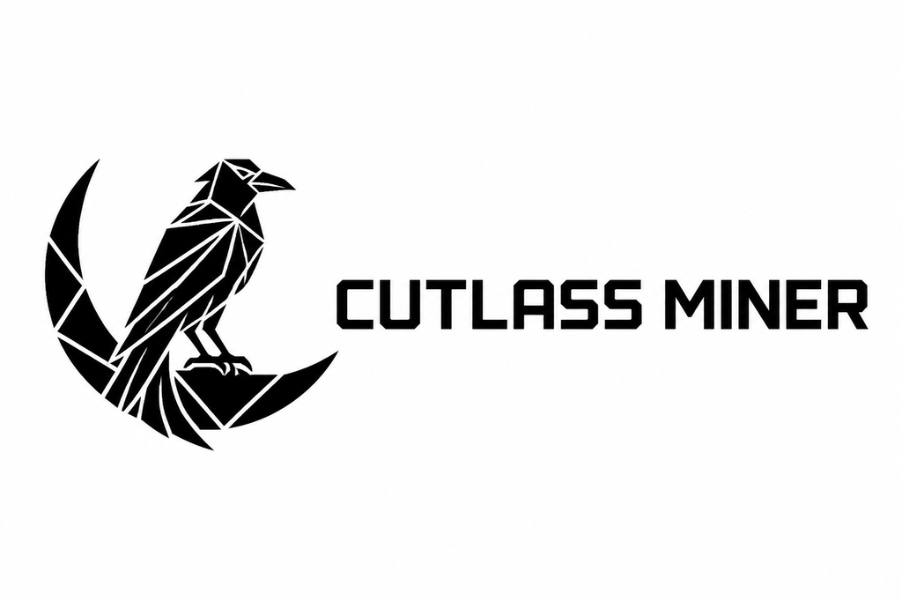

  

# Cutlass Miner — Pearl & KawPow

Multi-algorithm GPU miner for NVIDIA RTX 30-, 40- and 50-series cards
(sm_86 / sm_89 / sm_120). One download: the executable carries a native kernel
for each generation and picks the right one for the card it finds. Single
self-contained executable — no Python or CUDA toolkit install required.

## Algorithms

| engine | coin | status |
|---|---|---|
| `pearl-v3` | Pearl (PRL) | live-qualified, 24/7 |
| `kawpow` | Ravencoin (RVN) | live-qualified, pool-accepted shares |

## Requirements
- Windows 10/11 (x64)
- NVIDIA **RTX 30-, 40- or 50-series** GPU (sm_86 / sm_89 / sm_120)
- NVIDIA driver 580 or newer

A card outside those three architectures is refused at startup with an explicit
message rather than running a mismatched kernel.

## Setup
1. Open `config.json`.
2. Replace `PASTE_YOUR_PRL_WALLET_HERE` with your Pearl wallet address
   (`prl1...`).
3. (Optional) set `worker` to a label for the pool dashboard.
4. Save.

## Run
Double-click **`mine.cmd`** (or run it from a terminal). It starts the miner at
grid 32768 and streams pool status to the console. Stop with Ctrl+C.

## Config notes
- `--pearl-grid 32768` is the **maximum** supported grid (4096/8192/16384/
  32768). Larger = more sustained intensity (higher wattage, more shares).
- `--pearl-budget-mib 1024` sets the VRAM budget for the search workspace.
- `batch_seconds` = how often the pool batch is flushed.

## Measured on
The grid/depth configuration in this drop was tuned on an **RTX 5080** and
checked on an RTX 5090. The RTX 30- and 40-series kernels are measured on real
cards: an **RTX 3090** runs 143.7M candidates/s at grid 16384, and an
**RTX 4060** about 40.5M at grid 4096. Both needed the GEMM's register budget
capped at 128 so two CTAs fit per SM, which is what this build does; it is
worth roughly +16% on Ampere and +20% on Ada over the previous build, and
nothing measurable on 50-series (125 registers already).

## Fee
A fixed **2% dev fee** is baked into `pearl-miner.exe` (paid to the developer
wallet on accepted shares). It is not configurable from `config.json`; a `fee`
field in the config is rejected.

## Warranty
Provided as-is. Mining consumes significant power and generates heat; monitor
your GPU. No guarantee of profitability — returns depend on pool difficulty,
coin price, and your electricity cost.

## Branding
Logo and brand assets live in [`branding/`](branding/) — see
[`branding/BRAND.md`](branding/BRAND.md) for sizes, usage, and rules.
Strictly monochrome (black `#000000` / white `#ffffff`), no exceptions.
